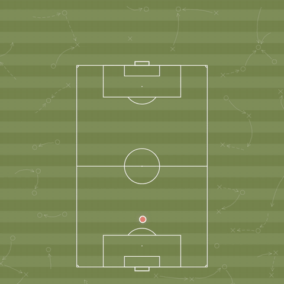

# TTA-Quantile: Learning Human Sports Motion Feasibility via Quantile Regression on Tracking Data

<div align="center">

[](PDF_LINK_PLACEHOLDER)
[](https://arxiv.org/abs/2610.36183)


<p align="center">
  <a href="assets/tta-quantile.mp4">
    
  </a>
  <br><sub>Click for the full-resolution video.</sub>
</p>
</div>

Code for the ACCV 2026 paper *Learning Human Sports Motion Feasibility via
Quantile Regression on Tracking Data* (citation below): a quantile
(τ=0.01) MLP that predicts the **empirical minimum time** for a player to reach
any point on the pitch, given their current kinematic state. Developed on
PFF FC football tracking (FIFA World Cup 2022), and evaluated cross-sport on NFL
(Big Data Bowl 2019) and NBA (SportVU) tracking.

## Setup

```bash
pip install -r requirements.txt   # Python ≥ 3.10; CUDA-enabled torch recommended
```

Tracking data is **not** distributed with this repository (provider licences).
Place each dataset under `data/<name>/raw/` following the layouts in the
*Datasets* table below, then build it with `scripts.build_dataset`. Select the
dataset with `KOGNIA_DATASET=<name>` (or `DATASET` in `src/config.py`).

**Pre-trained checkpoints** for the canonical runs ship in
`outputs/<dataset>/*.pt` (`mlp.pt` = base MLP, `mlp_profile_vmax*.pt` =
player-profile MLP, `*_seed4x.pt` = seed band, `mlp_arealoss_*` = area-aware
auxiliary loss, `outputs/ffpc_pass/` = ball-pass model).

## Pipeline

```
HDF5 tracking ─► clean ─► sample ─► transform ─► SUVAT filter ─► MLP ─► heatmaps
```

| Stage | Module | What it does |
|---|---|---|
| Load | `src/data_loader.py` | reads provider tracking into a shared `Match`, exposes per-(player, segment) views |
| Clean | `src/pipeline/cleaning.py` | gap-aware run segmentation, Savitzky-Golay smoothing, finite-difference derivatives, physics clipping |
| Sample | `src/pipeline/sampling.py` | dense (state, future-position, Δt) tuples over the 0.10–8 s training window |
| Features | `src/pipeline/features.py` | translate+rotate into heading frame → 6 normalised features |
| Baseline | `src/pipeline/suvat.py` | two-phase SUVAT physics model (noise filter + benchmark) |
| Model | `src/model/{mlp,loss,train,arealoss}.py` | 6→64→64→1 Softplus MLP, pinball loss + area-aware auxiliary loss, early stopping (+ profile variant: base 6 + per-player `vmax`) |
| Baselines | `src/model/motion_models.py` | 6 fitted paper motion models (Renkin a–d, Wu & Swartz, Fujimura) |
| Inference | `src/inference/heatmap.py` | full-pitch grid → batched forward pass → per-player heatmaps |
| Eval | `src/evaluation/{metrics,visualize}.py` | MAE, stratified bands, contour comparison |

## Run

```bash
python -m scripts.build_dataset   # raw tracking -> data/<dataset>/processed/samples.npz
python -m scripts.train           # -> outputs/<dataset>/mlp.pt
python -m scripts.evaluate        # MAE table + sample heatmap in outputs/<dataset>/
```

## Surfaces from your own tracking data

`scripts/compute_surface.py` computes the time-to-arrival surface of every
player at one frame of a tracking DataFrame, using the shipped checkpoints. No
dataset build is needed. The input is **forced to the FFPC (PFF FC) format**
that the `ffpc_match` models were trained on. A long table with one row per
(frame, player):

| column | type | FFPC convention |
|---|---|---|
| `period` | int | 1, 2 (3, 4 = extra time) |
| `frameNum` | int | frame counter at **29.97 fps**; gaps are allowed (no state is estimated across them) |
| `team` | str / int | `home` / `away` (or 0 / 1) |
| `jerseyNum` | int / str | shirt number, unique within a team |
| `x`, `y` | float | **metres, origin at the pitch centre**, x along the 105 m length, y along the 68 m width |
| `player_id`, `player_name` | optional | carried through to the output |

```bash
# csv / parquet / pkl already in FFPC format
python -m scripts.compute_surface --tracking my_match.parquet --frame 12345 --plot

# other column names / corner origin / other units are coerced, then validated
python -m scripts.compute_surface --tracking my.csv --frame 900 --period 2 \
    --rename frame=frameNum side=team shirt=jerseyNum --origin corner --scale 1.0

# raw PFF tracking files work directly
python -m scripts.compute_surface --tracking "data/ffpc_match/raw/<comp>/Tracking Data/3813.jsonl.bz2" --frame 5000
```

The script pins `KOGNIA_DATASET=ffpc_match`, cleans each player's track exactly
as at training time (Savitzky-Golay smoothing, finite-difference velocity and
acceleration, physics clipping, on ±2 s of context around the frame), and runs
the 6-feature MLP (default `outputs/ffpc_match/mlp.pt`; any 6-feature checkpoint
works via `--model`). It writes `outputs/surfaces/<name>_p<period>_f<frame>.npz`:

- `tta` `(n, nx, ny)`: per-player minimum time to reach each 1 m cell (s); `tta[i, ix, iy]` is at `(xs[ix], ys[iy])`.
- `team_min` `(2, nx, ny)`: the fastest arrival per team (home, away).
- `team`, `jersey`, `player_id`, `player_name`, `pos`, `vel`, `acc`: one entry per surface row.

The reachable set within a horizon h is `tta[i] <= h`. Optional outputs:
`--suvat` adds the physics baseline, `--plot` saves a home-vs-away
first-arrival map, and `--plot-players` saves one heatmap per player.
Players tracked at the frame but without a valid state (a run shorter than the
smoothing window, or a state that fails clipping) are reported and skipped.
`coerce_ffpc` rejects coordinates that are not in a centred 105×68 m frame and
suggests the fix (`--origin corner`, `--scale`, swapped axes). The frame rate is
not resampled, so convert other rates to 29.97 fps first.

From Python:

```python
import os; os.environ["KOGNIA_DATASET"] = "ffpc_match"   # before importing src
from src.tracking_df import coerce_ffpc, compute_surfaces, load_model

df = coerce_ffpc(my_df, rename={"frame": "frameNum"})
s = compute_surfaces(df, frame_num=12345, model=load_model("outputs/ffpc_match/mlp.pt", "cpu"))
s.tta, s.team_min, s.xs, s.ys, s.jersey
```

## Datasets

Data lives under `data/<name>/{raw,processed}`, one self-contained folder per
dataset. The active one is chosen by **`src/config.py::DATASET`**; the registry
records the only thing that genuinely differs between providers — the frame rate,
plus playing-surface size and a few per-sport knobs (everything downstream is pure physics):

| dataset | provider | fps | matches | raw layout |
|---|---|---|---|---|
| `ffpc_match` | PFF FC (FIFA WC 2022)   | 29.97 | 64 | `<comp>/{Tracking Data,Metadata,Rosters}/<id>.*` |
| `bdb_match`  | NFL Big Data Bowl 2019  | 10    | 1+ | `data/Big-Data-Bowl/Data/tracking_gameId_<id>.csv` |
| `nba_match`  | NBA SportVU 2015-16     | 25    | 636 | `data/NBA-Player-Movements/data/2016.NBA.Raw.SportVU.Game.Logs/*.7z` |

Every provider is read into one shared `Match` object (`src/data_loader.py`), so
the cleaning → sampling → features → SUVAT pipeline is identical across datasets.
Add a dataset by adding a registry entry + a reader that returns a `Match`
(see `src/ffpc.py`). `iter_matches()` yields all matches; `load_match()` yields
one (enough for the single-match eval scripts).

**Controlling build size.** Two knobs (set in `config`/registry):
- `FFPC_GAME_IDS` — list of PFF game ids to build (`None` = all 64).
- `state_stride` (per-dataset registry value, `STATE_STRIDE`) — keep every Nth
  valid state frame. At ~30 fps adjacent states are ~33 ms apart and highly
  redundant. FFPC defaults to **6** → ~2.1 M
  samples/game (~83 MB), vs ~12.7 M (~503 MB) at stride 1. All 64 games at
  stride 6 is **154 M samples (~5.9 GB)**; raise the stride or subset the games
  to shrink further.

## Splitting

`src/config.py::SPLIT_MODE` selects how val/test are held out:

- **`"match"`** — hold out whole matches (the canonical split; per-dataset
  default for multi-match datasets like `ffpc_match` / `nba_match`).
- **`"player"`** — hold out whole players for val/test. Zero trajectory
  leakage; directly tests generalization to unseen individuals. Used for the
  single-game `bdb_match`, where a match-level split is impossible.
- **`"block"`** — hold out contiguous 60 s time blocks within each half. More
  samples per split, but a trajectory can straddle a block boundary.

Keys are namespaced per match, so `player`/`block` never collide across matches.

**Why "continuous horizons" matters:** integer-second horizons (1..8 s)
imprint plateaus at 1/2/3/4 s in the learned surface — *label quantization*, not
model variance. Sampling continuous future offsets instead
(`HORIZON_MODE="random"`, the default; same sample count) cuts the surface
roughness ~5×. Set `HORIZON_MODE="fixed"` in `config.py` for integer horizons.

Compare SUVAT vs. MLP: `python -m scripts.compare_models`.

**Player-profile MLP.** `scripts/train_profile.py` appends each player's max
speed (95th percentile of their cleaned observations, the `meta_vmax` column)
to the base 6 features → a 7-feature MLP that personalises the reachable
envelope per player. Saves `outputs/<dataset>/mlp_profile_vmax.pt`.

**Paper motion models.** `src/model/motion_models.py` implements six theoretical
player-motion models as time-to-arrival predictors — Renkin et al. (2022) (a)
constant speed, (b) constant acceleration, (c) accel + speed limit, (d) two-
segment; Wu & Swartz (2025); and Fujimura & Sugihara (friction-damped). Fit on
TRAIN at Δt = 1 s by Renkin's precision objective (`scripts/fit_motion_models.py`
→ `outputs/<dataset>/motion_models.json`) and compared on the held-out TEST split
against SUVAT/MLP (`scripts/compare_motion_models.py`). They are fitted
physics benchmarks (like SUVAT), not the shipped predictor.

**Ball-pass pipeline.** A parallel `ffpc_match`-only pipeline predicts ball
arrival time through completed passes (`build_pass_dataset.py` → `train_pass.py` →
`evaluate_pass.py`) (passer-velocity
ablation: `scripts/ablate_passer_velocity.py`).

## Held-out results — `ffpc_match` (all 64 games, by-match split)

The full PFF dataset trained end-to-end: 154 M samples, **match-level split**
(45 train / 10 val / 9 test). Test set = **9 unseen matches, 21.5 M samples**.

The model is trained with the pinball loss at **τ = 0.01** plus the area-aware
auxiliary loss (`AREA_LAM = 0.01`), i.e. a 99 % coverage target. Held-out
metrics — coverage together with reachable area at Δt ∈ {1, …, 5} s, and the
cross-sport transfer tables — are reported in the paper; reproduce them with
`scripts.evaluate`, `scripts.eval_reachable_area` and
`scripts.cross_sport_area_table`.

## Citation

```bibtex
@inproceedings{gutierrez2026motionfeasibility,
  title     = {Learning Human Sports Motion Feasibility via Quantile Regression on Tracking Data},
  author    = {Guti{\'e}rrez-P{\'e}rez, Marc and Agudo, Antonio},
  booktitle = {Asian Conference on Computer Vision (ACCV)},
  year      = {2026}
}
```
